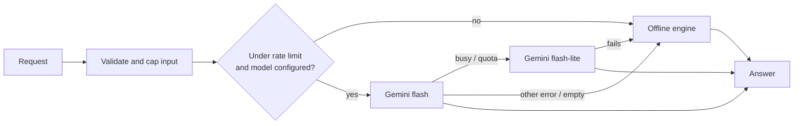

# grounded-portfolio-assistant

[](https://github.com/usmanbinamjad555/grounded-portfolio-assistant/actions/workflows/ci.yml)

A portfolio chatbot that **only answers from your own data**, and **always answers**.

This is a cleaned-up, standalone version of the "Ask my portfolio" assistant running on
[muhammadusman.sameemamjad.com](https://muhammadusman.sameemamjad.com). It is small on purpose (under 300 lines of
TypeScript) so the design decisions are easy to review.

```
POST /api/ask  { "messages": [{ "role": "user", "content": "Which projects can I try live?" }] }
→ 200          { "reply": "You can try Invoicely live.", "source": "model" | "offline" }
```

## How it works



| Piece | File | Why it exists |
|---|---|---|
| Grounded prompt | `src/prompt.ts` | The model gets the portfolio as compact facts plus rules that close real failure modes: invented facts, unearned titles ("top-rated"), quoted prices, off-topic use and prompt injection. |
| Model fallback | `src/model.ts` | Free-tier models get briefly overloaded. A `503`/`429` moves on to a lighter model; any other error (bad key, bad request) is a real failure and is not retried. |
| Offline engine | `src/offline.ts` | Deterministic keyword intents and a project search, with the same "never guess" rule. Visitors get an answer with no key, with the quota used up, or during an outage. |
| Input validation | `src/validate.ts` | Untrusted JSON becomes a safe history: known roles only (no smuggled `system` turns), trimmed and length-capped text, last 10 turns, ending with the user. |
| Rate limiting | `src/rate-limit.ts` | Per-client hourly cap that protects the free quota. Over the limit, visitors still get offline answers instead of an error. |
| Handler | `src/handler.ts` | One Web-standard `(Request) => Response` function: runs unchanged in Next.js route handlers, Vercel/Netlify functions, Cloudflare Workers, Deno or Bun. |

## Design decisions

- **Grounding over retrieval.** A portfolio is small enough to fit in the system prompt, so there is no vector
  database to run or keep in sync. The data file is the single source of truth for both the website and the assistant.
- **Never fail the visitor.** Every failure path ends in an offline answer with `source: "offline"`, never a 500.
  The `source` field keeps it honest and makes monitoring easy.
- **The model is injectable.** The handler takes a `generate(history, systemPrompt)` function, so tests run without
  network access, and swapping Gemini for another provider is one small function.
- **Cost stays at zero.** Gemini's free tier, a short answer style and a per-client limit.

## Run it

```bash
npm install
npm test                                        # 18 tests, no network needed
npm run ask -- "Which projects can I try live?"  # offline engine
GEMINI_API_KEY=... npm run ask -- "What do you build?"   # with Gemini (free key: aistudio.google.com)
```

Use your own data by editing `examples/sample-portfolio.ts`, and see `examples/next-app-route/route.ts` for a
Next.js API route.

## Production notes

- The in-memory rate limiter is per instance. On serverless with many instances, back the same interface with a
  shared store (the live site logs usage in Postgres and keys it by a hashed IP).
- Check the request origin before calling the handler if the endpoint should only serve your own site.

## License

MIT, © Muhammad Usman
